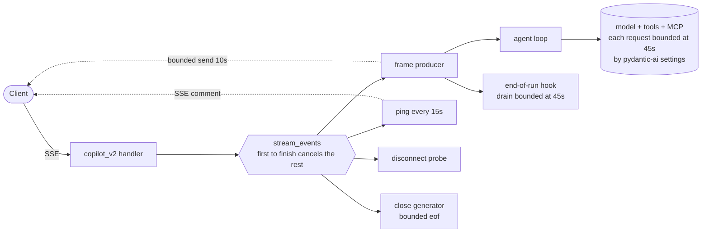

# Timeouts and teardown

A Copilot v2 turn holds an HTTP connection open while it talks to a model and to
MCP tools. Three things can go wrong, and none of them raise on their own: the
model never answers, the client vanishes, or the client stops reading. Each one
leaks a running agent and an unreleased request task.

Read this before adding code that waits on anything.

## The nets

Waits *inside* the agent run are bounded by pydantic-ai's own settings, wired
once in `_build_agent`. Waits in *our* code get one of the local nets.

| Net | What it does | Where |
| --- | --- | --- |
| `ModelSettings.timeout` | Bound each read of one model request, so it catches a gap between stream chunks. It does not bound the total request. | `agent.py` (`_build_agent`) |
| `tool_timeout` | Bound one native tool call. Expiry raises `ModelRetry`, so the model hears about it and can try something else. | `agent.py` (`_build_agent`) |
| MCP `read_timeout` | Bound one MCP request. Expiry also comes back as `ModelRetry`. | `agent.py` (`_build_agent`) |
| `asyncio.timeout` around the hook drain | Bound the end-of-run hook, which runs past the agent loop where those settings no longer reach. | `agent.py` (`_agent_turn`) |
| `asyncio.timeout` | Wait for one thing. Give up after N seconds. | stdlib |
| `aclosing` | Guarantee this generator is closed here, in this task. | stdlib |
| `BoundedSender` | Write to the client. One writer at a time, bounded. | `sse_transport.py` |

`stream_events` races the producer, the ping, and the disconnect probe, and the
winner cancels the rest. You do not add to it. It already wraps what you write.

The route's pre-flight gets none of that. It runs before `stream_events`, on a
response that is already open, so no ping proves the socket and no probe notices
the client leaving. A wait there needs its own `asyncio.timeout` or Sanic
truncates the response with nothing written. `run_guardrails_preflight` bounds
its policy call for that reason: the provider's client sets no deadline of its
own.

## How the transport is wired



Solid arrows are control flow. Dotted arrows are writes to the client.

## Which one

```
Waiting on anything outside this process?
  no                                -> nothing to do
  inside the agent run
    (model, native tool, MCP call)  -> already bounded by _build_agent; add nothing
  after the agent run
    (the end-of-run hook)           -> already bounded in _agent_turn
  anything else                     -> asyncio.timeout, never spanning a yield
Writing to the client?   -> the existing BoundedSender, never raw sse.send
Step is best-effort?     -> put the timeout INSIDE the try
Generator is yours?      -> aclosing around it
```

## Never bound across a yield

The stream layer used to wrap the agent loop in a per-pull deadline. It no longer
does, because every wait it was guarding now has a pydantic-ai setting of its own,
and the wrapper only made teardown ordering harder to reason about.

One gap is left over: the end-of-run hook runs after the agent loop, so no setting
covers it, and it waits on git. `_agent_turn` bounds it by draining it whole under
one `asyncio.timeout`, then yielding what came back:

```python
async with aclosing(end_of_run_hook(run_context)) as hook_events:
    final_events = []
    async with asyncio.timeout(self._config.stream_event_timeout):
        async for event in hook_events:
            final_events.append(event)
for event in final_events:
    yield event
```

Draining first is what keeps the deadline off the `yield`. A clock that spans a
`yield` times the client as well as your work, and cancellation then lands on
whoever is consuming the generator rather than on the hook. These are final
events emitted before RUN_FINISHED, so buffering them changes nothing a client
can observe.

Note what this does *not* do: cancelling the await does not stop a wedged `git`
child. The connection is released, which is the leak that mattered, but the
process is left behind. Bound `run_git_command` itself if orphaned children ever
show up in production.

### One await

Always `asyncio.timeout`, never a `timeout=` argument on a helper of your own.
When the awaited code can raise its own `TimeoutError`, decide on the scope's
`expired()` rather than on the exception type:

```python
try:
    async with asyncio.timeout(self._send_timeout) as deadline:
        await self._send(frame)
except TimeoutError as exc:
    if not deadline.expired():
        raise
    raise CopilotSendTimeoutException("...") from exc
```

`BoundedSender` needs that check because Sanic's `send` can raise its own
`TimeoutError`, which is not our send deadline.

### Closing a generator

`agent.iter(...)` and `node.stream(...)` arrive inside an `async with`, so their
owner closes them and you add nothing. A bare generator is yours to close:

```python
async with aclosing(my_generator()) as items:
    async for item in items:
        yield item
```

### Best-effort steps

```python
try:
    async with asyncio.timeout(timeout):     # inside, not around
        await self._thread_store.append_messages(thread_id, rows)
except Exception as exc:
    structlogger.warning("...", error_type=type(exc).__name__)
```

A timeout cancels the task, and `CancelledError` subclasses `BaseException`. With
the timeout outside the `try`, `except Exception` never sees it, and a slow store
write turns a good reply into a failed run.

## Error codes

Failures that fit an existing family need nothing. `classify_run_error` maps them,
or they land on `runtime_exception`. A new family means one value in
`RunErrorCode` and one branch in `classify_run_error`. Never derive a code from an
exception class name: class names move on dependency upgrades and the dashboards
break silently.

`code=timeout` now means a stalled end-of-run hook or a send that gave up.
Nothing else reports it.

A `ModelSettings.timeout` expiry lands on `model_error`, but it gets there by two
different routes. pydantic-ai's `_map_api_errors` covers the request call and the
peek at the first chunk, so a stall before any content arrives comes back as
`ModelAPIError`. It does not cover the rest of the iteration, so a stall *between*
chunks escapes as a raw `httpx.ReadTimeout` and would land on
`runtime_exception` — the one failure this page exists for. `classify_run_error`
therefore matches `httpx.TimeoutException` directly, which is the exception the
transport raises rather than a name it happens to carry. Widen that branch, do not
add a code, if a provider ever times out under a class of its own.

An MCP `read_timeout` or `tool_timeout` expiry never reaches the classifier at
all: pydantic-ai turns both into `ModelRetry`. The run fails only if the retry
budget runs out, also `model_error`.

## Configuration

| Variable | Default | Bounds |
| --- | --- | --- |
| `COPILOT_V2_STREAM_EVENT_TIMEOUT` | `45.0` | one model read, one native tool call, one MCP request, the whole end-of-run hook |
| `COPILOT_V2_PING_INTERVAL` | `15.0` | how often the transport proves the socket is alive |
| `COPILOT_V2_SEND_TIMEOUT` | `10.0` | one write to the client, and the post-cancel teardown |

Nothing bounds a whole turn. The ceiling is emergent: `COPILOT_MAX_AGENT_STEPS`
model requests, a pydantic-ai tool retry budget of 1, and 45s per step. Add a
turn-level bound only if a real run shows the emergent ceiling is too high.

The hook bound is the only net covering the run after the agent loop finishes.
Without it a wedged `git` holds the connection open forever: the ping keeps the
socket healthy, so neither the disconnect probe nor Sanic reclaims the request.

Keep the event timeout below Sanic's `RESPONSE_TIMEOUT`, a per-write idle timer
that defaults to 60s and that `main.py` does not override. Above it, the connection
drops before the deadline fires and the client sees a silent truncation. Keep the
send timeout below the event timeout, so a slow reader never looks like a stalled
agent.

## Mistakes

| Do not | Because |
| --- | --- |
| Put a timeout around a `yield` | It times the consumer, not your work. |
| Relay a generator under a deadline | Drain it whole instead, so no yield is timed. |
| Give a helper its own `timeout=` argument | Use `asyncio.timeout` at the call site. |
| Call `sse.send` raw | Unbounded, and it interleaves with the ping. |
| Wrap a best-effort `try` in a timeout | `CancelledError` is not an `Exception`. |
