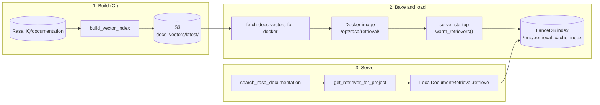

# Document retrieval

In-process search over Rasa's documentation. It grounds the copilot's
`search_rasa_documentation` tool, in both the chat agent and the
training-error-analysis agent, and the retrieval eval (`RetrievalTask`) uses it to
measure search quality.

There are two corpora today:

| Corpus | Source | Searched for |
|---|---|---|
| `rasa-docs` | [RasaHQ/documentation](https://github.com/RasaHQ/documentation), the Mintlify site served at rasa.com/docs | CALM v1 projects, and every other project as a fallback |
| `mantle-docs` | `mantle-docs/` in this repo, a Mintlify site | Mantle (CALM v2) projects |

The design is **pull and serve**. Documents are chunked and embedded once, in CI, into
a self-contained parquet file. The copilot never embeds documents: at startup it loads
the precomputed vectors into a local LanceDB index, and per query it embeds only the
query and searches.

The code lives in this package, in the copilot wiring in
[`copilot/pydantic_ai/document_search.py`](../copilot/pydantic_ai/document_search.py),
and in the CI under `.github/`.

## Workflow



### 1. Build the vectors (CI)

| | |
|---|---|
| Trigger | The documentation repo sends a `repository_dispatch` of type `build-docs-vector-index` when its docs change. You can also run the workflow by hand, with the `docs_ref` and `upload_to_s3` inputs. |
| Runs | [`build-docs-vector-index.yml`](../../../.github/workflows/build-docs-vector-index.yml), which calls the composite action [`build-docs-vector-index`](../../../.github/actions/build-docs-vector-index/action.yml) |
| Output | `docs_vectors.parquet` and `manifest.json` in S3, under `docs_vectors/<docs commit>/` and `docs_vectors/latest/` |

The action checks out both repos, installs the `copilot-v2` extra, restores the
FastEmbed model cache, and runs:

```bash
poetry run python -m rasa.builder.document_retrieval.local.build_vector_index \
  --repo-path documentation \
  --output artifacts/docs_vectors.parquet \
  --manifest artifacts/manifest.json \
  --embed-model BAAI/bge-small-en-v1.5 \
  --embed-cache-dir .embed_model_cache
```

`build_vector_index` parses the checkout, then chunks and embeds every page and writes
the parquet. It reads the file back to validate the row count, the vector type and
dimension, and the footer metadata, then writes the manifest. A failed run posts to
`#rasa-pro-alerts`.

- **Only `rasa-docs` goes through the S3 bake.** The release, CI wheel and public ECR
  workflows build `mantle-docs` with the same action and bundle it in the package, so
  release wheels, CI wheels, the release `rasa/rasa-pro` image and the public ECR dev
  image ship it. You can build it the same way locally
  (`--corpus mantle-docs --repo-path mantle-docs`).
- **The artifact comes from this repo's code at the time of the run.** A change to
  parsing or chunking reaches production only after the workflow runs again.

### 2. Bake and load

**Wheel and image build.** The Rasa Pro image builds (CI, release, and the public ECR
publish) and the shared
[`build-docs-indexes`](../../../.github/workflows/build-docs-indexes.yml) workflow,
which feeds the release and CI wheels, run
[`fetch-docs-vectors-for-docker`](../../../.github/actions/fetch-docs-vectors-for-docker/action.yml).
The action:

- downloads `docs_vectors/latest/docs_vectors.parquet` into
  `rasa/builder/document_retrieval/local/data/` and the manifest into `docker/retrieval/`;
- fails the build if the manifest names an unexpected embedding model, or if the
  parquet's sha256 doesn't match the manifest;
- for image builds only, caches the FastEmbed ONNX model into
  `docker/retrieval/embed_model_cache/`.

The wheel bundles every parquet in `rasa/builder/document_retrieval/local/data/`, and
the images install that wheel. [`Dockerfile`](../../../Dockerfile) and
[`docker/Dockerfile.lite`](../../../docker/Dockerfile.lite) copy only the model cache
into `/opt/rasa/retrieval/` and set:

```bash
LOCAL_EMBED_CACHE_DIR=/opt/rasa/retrieval/embed_model_cache
LOCAL_INDEX_CACHE_DIR=/tmp/.retrieval_cache_index
```

[`verify-docker-retrieval-artifacts.sh`](../../../.github/scripts/verify-docker-retrieval-artifacts.sh)
checks published images for the model cache, the variables, both bundled artifacts and
the `rasa-docs` checksum.

**Server startup.** The builder's `after_server_start` hook in [`main.py`](../main.py)
calls `warm_retrievers()`, which builds one retriever per corpus, Mantle first and
then `rasa-docs`:

1. `LocalDocumentRetrieval.from_artifact` gets the shared embedding model, which loads
   once for all corpora, and creates a `LocalIndex` at
   `$LOCAL_INDEX_CACHE_DIR/<corpus>/<key>/`.
2. `ingest_vector_artifact` reads only the parquet footer first. It refuses an artifact
   built with a different embedding model, and skips loading if the index's
   `meta.json` already records this corpus version.
3. Otherwise it loads every row into LanceDB and stamps `meta.json`.

Containers start with an empty `/tmp`, so production always loads at startup.

- **If the `rasa-docs` build fails,** startup logs a warning and every doc search
  returns an error.
- **If the Mantle artifact is missing or broken,** Mantle projects fall back to
  `rasa-docs`. Release wheels, CI wheels, the release `rasa/rasa-pro` image and the
  public ECR dev image from `publish-to-public-ecr.yml` bundle both artifacts
  inside the package, so neither variable needs a setting there.
  Other images (`docker/Dockerfile.lite`, mantle-lite and test images) don't bundle it,
  so there Mantle projects fall back to `rasa-docs`.

### 3. Serve

On every `search_rasa_documentation` call:

1. **Pick the corpus.** `search_documentation(query, project_path)` calls
   `get_retriever_for_project`. A Mantle project uses `mantle-docs` when it's loaded;
   everything else uses `rasa-docs`. Mantle projects are detected by
   `project_uses_mantle_layout`, the same check that picks the system prompt.
2. **Search.** `LocalDocumentRetrieval.retrieve` embeds the query and runs a vector
   search for the top 5 chunks. It runs in a worker thread, so the event loop stays
   free.
3. **Return.** The results become `DocumentSearchToolResponse` documents (title, URL,
   content), and results without a URL are dropped. A failure comes back as an `error`
   string; the tool never raises.

## Components

The components below are in data-flow order. For each: what it is, why it exists, and
what it hands to the next one.

| Stage | Component | File |
|---|---|---|
| Input | `SourceDocument` | [`source.py`](source.py) |
| Input | `BaseCorpusSource`, `MintlifyCheckoutSource` | [`corpus.py`](corpus.py) |
| Input | Mintlify parser | [`mintlify.py`](mintlify.py) |
| Build | `Chunker`, `Chunk` | [`local/chunking.py`](local/chunking.py) |
| Build | `Embedder` | [`local/embedding.py`](local/embedding.py) |
| Build | Build pipeline and CLI | [`local/build_pipeline.py`](local/build_pipeline.py), [`local/build_vector_index.py`](local/build_vector_index.py) |
| Build | Parquet artifact | [`local/parquet_artifact.py`](local/parquet_artifact.py) |
| Serve | `LocalIndex` | [`local/index.py`](local/index.py) |
| Serve | Vector store | [`local/vector_store.py`](local/vector_store.py), [`local/lancedb_store.py`](local/lancedb_store.py) |
| Serve | `LocalDocumentRetrieval`, `BaseRetriever` | [`local/retrieval.py`](local/retrieval.py), [`base.py`](base.py) |
| Serve | Copilot wiring | [`../copilot/pydantic_ai/document_search.py`](../copilot/pydantic_ai/document_search.py) |
| All | Configuration | [`local/config.py`](local/config.py), [`../config.py`](../config.py) |

### `SourceDocument`

- **What:** one whole document, before chunking: `id`, `title`, markdown `content`,
  `source` (the corpus name), `url`, `version` (a content hash), and free-form
  `metadata`.
- **Why:** every corpus converts its records into this one shape, so chunking,
  embedding and indexing never depend on where a document came from.
- **Next:** the chunker. `metadata["topic"]` becomes each chunk's filterable topic.

### Corpus sources

- **What:** `BaseCorpusSource.load()` returns `(documents, corpus_version)`.
  `MintlifyCheckoutSource(docs_root, site)` parses a local checkout of a Mintlify site
  and uses the checkout's git commit as the version.
- **Why:** one interface for where documents come from. `corpus_version` identifies
  the snapshot. It's stamped into the artifact and the index, and an index that
  already holds that version is reused as is.
- **Next:** the build pipeline, in CI and in evals.

### Mintlify parser

- **What:** `build_index(docs_root, site)` walks every `.mdx` page Mintlify publishes,
  skipping `snippets/` and the paths in `.mintignore`. It strips frontmatter, imports
  and JSX, and returns `DocPage`s.
  - `MintlifySite` holds what differs per site: the corpus name, base URL and topic
    rules.
  - `MINTLIFY_SITES` lists the known sites, and supplies the choices for
    `build_vector_index --corpus`.
- **Why:** both corpora are Mintlify sites, so one parser serves both. Mintlify's own
  rules decide which pages are published and at which URL.
- **Next:** `DocPage.to_source_document(site)` produces the `SourceDocument`s.

### Chunker and `Chunk`

- **What:** `Chunker.chunk_document` splits a document into one chunk per h1–h3
  section. It:
  - ignores `#` lines inside fenced code blocks;
  - prefixes every chunk with the page title;
  - splits sections over about 683 words into overlapping windows of about 384 words,
    each keeping the title and heading (derived from `chunk_size` 512 and
    `TOKENS_PER_WORD`);
  - drops repeated chunks within a page, keeping `chunk_index` contiguous.

  `Chunk` is the stored record: `text`, `doc_id`, `url`, `title`, `topic`, `version`
  and `chunk_index`.
- **Why:** whole pages are too coarse to retrieve, and headings are the docs' natural
  units. `Chunk` is also the single definition of a stored row: the build rows, the
  parquet columns and the store's search hits all derive from it, through `to_row` and
  `from_row`.
- **Next:** chunk texts go to the embedder, and chunks plus their vectors become rows.

### Embedder

- **What:** `Embedder.encode(texts)` returns float32 vectors. `FastEmbedEmbedder` runs
  `BAAI/bge-small-en-v1.5` (384 dimensions) on ONNX Runtime, without torch.
- **Why:** documents (in CI) and queries (at serving time) must be embedded by the same
  model, or their vectors can't be compared. `EmbedConfig` names the model, and the
  artifact records it.
- **Next:** vectors for rows during the build, and for queries during serving.

### Build pipeline and CLI

- **What:**
  - `build_chunk_rows` chunks and embeds documents into rows.
  - The `build_vector_index` CLI turns a docs checkout into the parquet and manifest.
  - `sync_index` fills a local index straight from documents; the eval uses it through
    `from_documents`.
- **Why:** this is the offline half of pull and serve. The copilot never imports
  `build_pipeline`, so serving never loads the build code.
- **Next:** the parquet artifact.

### Parquet artifact

- **What:** one self-contained file.
  - **Columns:** `vector` (a fixed-size float32 list) plus the `Chunk` fields.
  - **Footer:** the key `rasa_retrieval_meta` holds the build config: `embed_engine`,
    `embed_model`, `embed_dim`, `corpus_version`, `document_count`, `chunk_count` and
    `created_at`.
  - **`manifest.json`:** the same build config plus `docs_commit` and
    `parquet_sha256`, for S3 and the image builds.
- **Why:** a store-agnostic hand-off between CI and serving. The column layout is the
  compatibility contract with the artifacts already in S3, and
  `test_columns_match_the_published_artifact_schema` pins it.
- **Next:** S3, then the image, then `ingest_vector_artifact`.

### `LocalIndex`

- **What:** one on-disk index at `<index_cache_dir>/<corpus>/<key>/`, where the key
  hashes the embedding engine and model.
  - It owns the vector store and `meta.json`, which records the corpus version and the
    embedding config.
  - `is_current(version)` and `replace(rows, ...)` are the only way to fill it.
    `ingest_vector_artifact` uses them for parquet files, and `sync_index` uses them for
    documents.
- **Why:** computing the folder in one place keeps the store and its stamp together and
  keeps corpora from sharing a table. The version check lets a restart reuse an index
  instead of loading it again.
- **Next:** its store answers the searches.

### Vector store

- **What:** `BaseVectorStore` defines `exists`, `add`, `drop`, `ensure_text_index` and
  `search`. `LanceDBVectorStore` keeps an embedded LanceDB table named `chunks` and
  returns `StoreHit(chunk, score)` objects.
- **Why:** a seam, so the database can change without touching chunking, embedding or
  the retriever. The full-text index is built only in hybrid search mode.
- **Next:** search hits, back to the retriever.

### Retriever

- **What:** `LocalDocumentRetrieval` has two constructors:
  - `from_artifact(config, parquet_path, corpus=...)`, for serving;
  - `from_documents(config, documents, corpus_version, corpus=...)`, for evals.

  Both accept a shared `embedder`. `retrieve(query, top_k=, filters=)` embeds the query
  and searches in a worker thread. The only supported filter is `topic`.
- **Why:** `BaseRetriever` in `base.py` is the contract callers code against. It never
  raises: it reports `OK`, `EMPTY` or `ERROR` in a `RetrievalResponse`, so callers branch
  on data rather than exceptions.
- **Next:** `RetrievalResult`s, each with content, title, URL, score, source id, topic
  and chunk index.

### Copilot wiring

- **What:** `document_search.py`:
  - builds one retriever per corpus and one shared embedder, cached for the process;
  - builds them all at startup with `warm_retrievers`;
  - picks a corpus by project layout in `get_retriever_for_project`;
  - registers the `search_rasa_documentation` tool on the chat and analysis agents
    with `register_document_search_tools`.
- **Why:** keeps the corpus choice and the failure policy in one place. A `rasa-docs`
  failure surfaces as a search error, and a Mantle failure falls back to `rasa-docs`.

### Configuration

Serving reads these environment variables, defined in [`rasa/builder/config.py`](../config.py):

| Variable | Default | Meaning |
|---|---|---|
| `LOCAL_VECTORS_PARQUET_PATH` | the bundled `rasa/builder/document_retrieval/local/data/docs_vectors.parquet` in release wheels, CI wheels and images built by CI, otherwise unset | The `rasa-docs` artifact. Required: without it, doc search returns errors. An empty value counts as unset. |
| `LOCAL_MANTLE_VECTORS_PARQUET_PATH` | the bundled `rasa/builder/document_retrieval/local/data/mantle_docs_vectors.parquet` in release wheels, CI wheels, the release `rasa/rasa-pro` image and the public ECR dev image, otherwise unset | The `mantle-docs` artifact. Optional: without it, Mantle projects use `rasa-docs`. An empty value counts as unset. |
| `LOCAL_INDEX_CACHE_DIR` | `.retrieval_cache_index` | Where the LanceDB indexes live. |
| `LOCAL_EMBED_CACHE_DIR` | `.embed_model_cache` | Where the embedding model is loaded from, or downloaded to. |

Search behaviour is set in [`local/config.py`](local/config.py):

- **`LocalRetrievalConfig`:** `top_k` (default 5), `search_mode` (vector or hybrid),
  `topic_filter`, `index_cache_dir` and `vector_store`.
- **`EmbedConfig`:** the engine, model, cache dir and batch size.
- **`ChunkingConfig`:** `chunk_size` (512) and `chunk_overlap` (64). Every build
  currently uses the defaults.

### Extension points

Four abstract classes are the seams:

- `BaseCorpusSource`, for where documents come from;
- `Embedder`;
- `BaseVectorStore`;
- `BaseRetriever`.

The recipes below use them.

## Extending

### Add a new source or corpus

For content that isn't a Mintlify site, such as skills, tools or chat history:

1. **Implement `BaseCorpusSource`** in `corpus.py`. `load()` returns
   `(List[SourceDocument], corpus_version)`.
   - `id`: stable for each document.
   - `url`: required in practice, because the copilot drops results without one.
   - `content`: markdown. h1–h3 headings become the chunk boundaries.
   - `metadata["topic"]`: optional. It becomes the chunk's filterable topic.
   - `corpus_version`: must change whenever the content changes, or an existing index
     is reused unchanged.
2. **Pick a corpus name** that matches `^[a-z0-9][a-z0-9_-]*$`. It becomes the index
   folder name and the `--corpus` value.
3. **Build an artifact.** Today `build_vector_index` only reads Mintlify checkouts: its
   `--corpus` choices come from `MINTLIFY_SITES`, and `_load_corpus` uses
   `MintlifyCheckoutSource`. Extend `_load_corpus` to construct your source. (A new
   Mintlify site only needs a `MintlifySite` entry in `MINTLIFY_SITES`.)
4. **Serve it** in `document_search.py`:
   - add a `LOCAL_<NAME>_VECTORS_PARQUET_PATH` setting to `rasa/builder/config.py`;
   - add a cached getter that calls `_build_retriever(config.LOCAL_<NAME>_VECTORS_PARQUET_PATH, "LOCAL_<NAME>_VECTORS_PARQUET_PATH", "<name>")`;
   - choose its failure policy: raise like `rasa-docs`, or return `None` and fall back
     like Mantle;
   - route to it in `get_retriever_for_project`, or expose it through a separate tool;
   - add it to `warm_retrievers`.
5. **Ship it:**
   - build and upload the artifact in CI under its own S3 prefix (the current
     `docs_vectors/` keys belong to `rasa-docs`);
   - fetch it in `fetch-docs-vectors-for-docker`;
   - copy it and set its variable in both Dockerfiles;
   - extend `verify-docker-retrieval-artifacts.sh`.
6. **Test** the source in `tests/builder/document_retrieval/test_corpus.py`, and the
   getter and dispatch in `tests/builder/copilot/pydantic_ai/test_document_search.py`.

### Swap the embedder or vector store

**A new vector store:**

1. Subclass `BaseVectorStore`. `add` receives `Chunk.to_row` dicts (`vector` plus the
   chunk fields). `search` returns `StoreHit(chunk=Chunk.from_row(row), score=...)`.
2. Add its name to `LocalRetrievalConfig.vector_store`, and build it in `_build_store`
   in `local/index.py`.
3. Handle the `where` filter. `_build_where` in `local/retrieval.py` produces a
   SQL-style predicate such as `topic = 'studio'`. Either translate it in your store or
   change `_build_where`.
4. Make `search` safe to call from several threads at once, since searches run in
   worker threads.

**A new embedder:**

1. Subclass `Embedder`. `encode(texts)` returns a float32 array of shape `(n, dim)`,
   and `dim` gives the dimension.
2. Add its engine to `EmbedConfig.embed_engine`, and build it in `build_embedder`.
3. Make `encode` safe to call concurrently. One instance serves every corpus, from
   worker threads.
4. Changing the engine or model changes the index key and invalidates every artifact.
   Ingest refuses a parquet built with another engine, model or dimension
   (`IndexConfigMismatch`). Rebuild all artifacts, and update:
   - `EMBED_MODEL` in `build-docs-vector-index.yml`;
   - the `embed_model` default in `fetch-docs-vectors-for-docker`;
   - the `EmbedConfig` default.

### Change chunking or chunk fields

**Chunking rules** live in `local/chunking.py`.

- **Clear local caches after a change.** Chunking isn't part of the index key, so an
  index for the same corpus version survives a chunking change. Delete your local
  `index_cache_dir` to see the change. Production containers start empty anyway.
- **Production needs a rebuild.** Production gets the new chunks only when the parquet
  is rebuilt, so run `build-docs-vector-index` after merging.
- **Measure the effect.** Run the retrieval eval before and after the change; see the
  [evaluator README](../evaluator/README.md).

**Chunk fields:** the fields of `Chunk` are the parquet columns and the store rows.

1. Only `str` and `int` fields are supported, stored as Arrow string and int32. Any
   other type fails the build.
2. Update the pinned schema in `test_columns_match_the_published_artifact_schema`, in
   `tests/builder/document_retrieval/local/test_parquet_artifact.py`.
3. Mind the rollout order. New code can't load an artifact that lacks the new column,
   but old code ignores extra columns. Images built from the new code fail to load the
   old `latest` artifact, and doc search returns errors until it's rebuilt. So rebuild
   the artifact right after merging.
4. To show the field to the copilot, map it in `LocalDocumentRetrieval._hit_to_result`
   and in `DocumentSearchDocument`.
