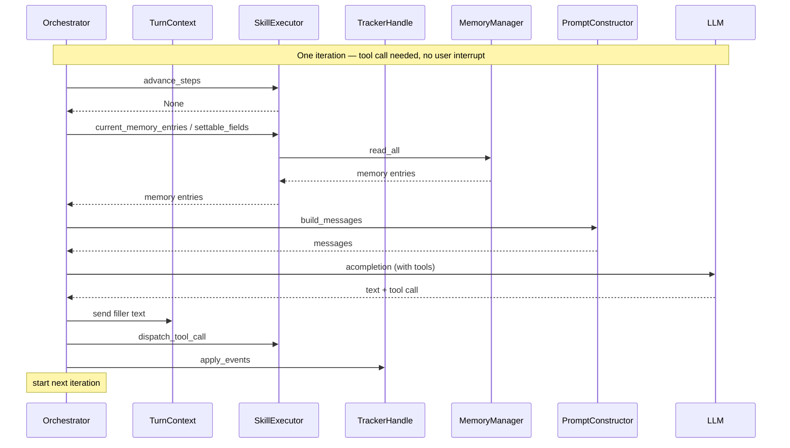
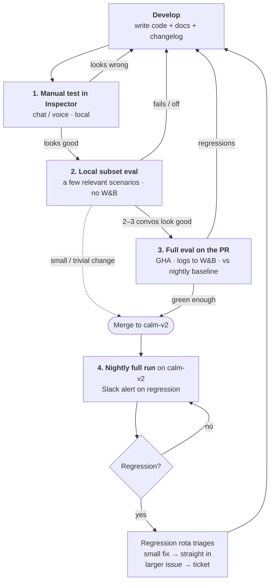

# Mantle — Internal Developer Guide

Internal, developer-facing notes for working on the **Mantle** engine. This is
the engineering companion to the customer-facing Mantle docs — it covers *how we build and
ship*, not how to author agents.

- **Engine code:** [`rasa/mantle/`](.) (you are here)
- **Engine tests:** [`tests/mantle/`](../../tests/mantle/)
- **Docs (customer-facing):** [`mantle-docs/`](../../mantle-docs/) — [rendered publicly](https://rasa-2f7eb63d.mintlify.site/) straight off the `calm-v2` branch
- **Branch:** all Mantle code and docs live on `calm-v2`, **not** `main`. Branch off `calm-v2` and PR back into it.

> This guide lives on the `calm-v2` branch alongside the code it describes. Keep it current in
> the same PR as the change it documents.

## Contents

- [Overview](#overview)
- [Local setup](#local-setup)
- [Architecture](#architecture)
- [Tracker events](#tracker-events)
- [Dialogue stack](#dialogue-stack)
- [Developer workflow](#developer-workflow) — **the main section**
- [Testing](#testing)
- [Release process](#release-process)
- [Troubleshooting](#troubleshooting)

---

## Overview

**Mantle** is Rasa's LLM-native dialogue engine: you describe agent behaviour
in natural-language **skills** (`skill.md`, tools, memory), and the orchestrator runs the
conversation — routing, tool calls, digressions, and progressive control (ordered blocks,
constraints) when you need guarantees. That differs from **CALM v1**, which centres on
flows, NLU, and the classic policy / domain graph (`config.yml`, `domain/`, `data/`).
Mantle projects use `agent.yml` + `integrations.yml` + `skills/` instead.

Customer-facing concepts (skills, progressive control, the runtime loop) are documented in
the [Mantle docs](https://rasa-2f7eb63d.mintlify.site/) (source: [`mantle-docs/`](../../mantle-docs/)).
This guide is the engineering companion — how the engine is built, tested, and released.

## Local setup

### Install Rasa

Mantle ships in the main `rasa` package (no separate Poetry extra). You can
either install the shared **dev release** or work from this repo.

#### Option A — `rasa-pro` 3.19.0.dev2 (first shared Mantle dev release)

For trying Mantle or building agents without editing engine code, install the published
dev build from the private registry:

```bash
pip install "rasa-pro==3.19.0.dev2" \
  --extra-index-url=https://europe-west3-python.pkg.dev/rasa-releases/rasa-pro-python/simple/
```

You need registry access; see [`README-INTERNAL.md`](../../README-INTERNAL.md) for
auth / registry notes.

#### Option B — from this repo (engine development)

On the `calm-v2` branch, use **>=Python 3.10, <3.14** (e.g. via [pyenv](https://github.com/pyenv/pyenv)),
install [Poetry](https://python-poetry.org/docs/#installation), then from the repo root:

```bash
make install
```

That installs dependencies and `rasa` in editable mode. Optional extras
(`make install-full`) are for NLU / TensorFlow / etc. and are **not** required for
Mantle engine development. Full packaging notes live in [`README-INTERNAL.md`](../../README-INTERNAL.md).

### Create a first Mantle agent

From any empty directory (with `rasa` on your `PATH`):

```bash
rasa init --engine mantle
```

`--engine mantle` selects the Mantle scaffold. Without it, interactive
`rasa init` defaults to CALM v1; with `--no-prompt` and no `--engine`, it scaffolds
CALM v1 as well — always pass `--engine mantle` when you want a Mantle project.

What the command does:

1. **Copies the Mantle project template** (`rasa/cli/project_templates/mantle/`) into
   the target directory — typically `agent.yml`, `integrations.yml`, a demo skill
   (`skills/view_transactions/` with `skill.md`, mock `tools.py`, and `memory.yml`),
   and an `AGENTS.md` for coding agents.
2. **Collects secrets** (`RASA_LICENSE`, `OPENAI_API_KEY`) from the environment or
   interactive prompts and writes them to a project `.env` (mode `0600` on POSIX).
3. **Installs IDE skills** for Cursor and Claude Code (`rasa skills install mantle`
   equivalent).
4. **Optionally validates, trains, and opens Inspector** so you can chat with the
   starter agent immediately.

Non-interactive example:

```bash
export RASA_LICENSE=...
export OPENAI_API_KEY=...
rasa init --engine mantle --no-prompt --init-dir ./my-agent
```

Use `--no-train` if you only want the scaffold and skills installed.

### What you need to run the init agent

From the project directory:

| Requirement | Why |
|---|---|
| **`RASA_LICENSE`** in `.env` (or the environment) | Required for `rasa train` / `rasa inspect`. `RASA_PRO_LICENSE` is still accepted as a read fallback; Mantle writes `RASA_LICENSE`. |
| **`OPENAI_API_KEY`** in `.env` | Default LLM in the scaffolded `integrations.yml`. |
| **`rasa train`** | Validates the project and packages a model archive into `models/`. |
| **`rasa inspect`** | Opens the Inspector UI to talk to the agent (chat; use voice Inspector for voice work). |

```bash
cd my-agent
rasa train
rasa inspect
```

Re-run `rasa train` after editing `agent.yml`, `integrations.yml`, or any skill.
Customer-facing getting-started notes live in [`mantle-docs/getting-started.mdx`](../../mantle-docs/getting-started.mdx).

## Architecture

Mantle runs one user turn as an **orchestrator loop**: advance any
deterministic skill steps, and when those hand off, build a prompt and call the LLM.
Tool calls and stack/memory updates go through `SkillExecutor` onto an append-only
tracker. The same outer loop covers autonomous and hybrid skills — the difference is
what `advance_steps` does before each LLM call and what the prompt exposes.

| Component | Role |
|---|---|
| `Orchestrator` | Owns the per-turn LLM iteration loop (up to 10 iterations) |
| `SkillExecutor` | Advances deterministic steps; dispatches tool calls; owns skill lifecycle |
| `TrackerHandle` | Single read/write surface for stack + events (append-only tracker) |
| `MemoryManager` | Schema-aware memory read/write over tracker slots |
| `PromptConstructor` | Builds system + history + user messages from `PromptContext` |

### Shared turn loop (example)

The sequence diagram below shows **one iteration** of a turn where the engine needs to
**call a tool** and the **user does not interrupt**. `advance_steps` returns `None` (hand
off to the LLM), the orchestrator builds the prompt, calls the LLM, sends filler text,
dispatches the tool, then starts the next iteration. Other outcomes (`WAIT`, `CONTINUE`,
rephrase, text-only, barge-in, digression, RAG, …) are covered on
[Mantle — Sequence Diagrams](https://www.notion.so/rasa/Mantle-Sequence-Diagrams-3acb9c0d544a80b3b861ccf9b51da985).



### Where to find what

All paths below are under the root package **`rasa/mantle/`**.

| Path | What belongs here |
|---|---|
| `processor.py` | Message-processor entry for Mantle — wires a user message into a turn and the orchestrator (kept separate from the CALM v1 / NLU processor). |
| `inspector.py` | Wire contract for Inspector NextGen (skill catalog + per-tracker skill state JSON). Change in lock-step with the Inspector frontend Zod schemas. |
| `orchestration/` | Turn loop and lifecycle execution: `orchestrator.py` (LLM iterations), `skill_executor.py` (advance steps / dispatch tools / stack), `turn_context.py` (ambient send + cancellation), plus correction / memory validation tools / responses. |
| `skills/` | Skill authoring model and compile path: markdown skills → catalog, prose vs ordered blocks, conditions, steps, validation. Not the per-turn runtime loop. |
| `state/` | Tracker façade for the engine: `tracker_handle.py`, stack/frame helpers, pending tool confirmation, turn helpers. Events stay append-only. |
| `memory/` | Memory field schema, discovery, and `MemoryManager` read/write over slots. |
| `tools/` | `@tool` decorator, loading skill tools, tool results / validation. |
| `llm/` | LLM client, tool schemas offered each iteration, call logging. |
| `prompts/` | System-prompt assembly (`system_prompt.py`, `constructor.py`) and Jinja snippets under `prompts/templates/`. Prompt text lives here — not in the orchestrator. |
| `config/` | Engine-side config shapes (e.g. integrations / MCP). |
| `model_archive/` | Packaging / bootstrap of a trained Mantle model archive. |
| `default_skills/` | Built-in engine-managed skills (e.g. continue-interrupted, completed wrap-up). |
| `validation.py` | Project validation before train / package. |

### Tracker events

Skill-scoped lifecycle is written as `Skill*` (`SkillActivated`, `SkillCompleted`,
`SkillCancelled`, `SkillInterrupted`, `SkillResumed`). Ordered-block lifecycle is
written as `OrderedBlock*` (`OrderedBlockEntered`, `OrderedBlockCompleted`,
`OrderedBlockCancelled`, `OrderedBlockInterrupted`, `OrderedBlockResumed`). Mantle no
longer emits the CALM `Flow*` events (`FlowStarted`, `FlowCompleted`, `FlowCancelled`,
`FlowInterrupted`, `FlowResumed`). The payload `block_id` is the authored id
(`submit`, `main`), not the compiled `{skill}__{block}` flow id. `OrderedBlockEntered`
carries `skill_id` and `block_id` only; the other four also have `step_id`.

When a guided skill starts, `SkillActivated` is followed by `OrderedBlockEntered`.
Hybrid prose omits the ordered-block event; entering an internal block of an
already-active skill omits a second `SkillActivated`. `SkillActivated` /
`SkillCompleted` carry `skill_id` only; cancel / interrupt / resume also have `step_id`.
One `SkillCancelled` per cancelled skill even if several blocks are cancelled with it.
Digression metadata (`metadata.digression`, see `state/repair_metadata.py`) is stamped
on `SkillInterrupted`.

Tool dispatches emit `ToolExecuted` only. When a `skill_id` is passed it is
stored on that event's metadata. CALM emit sites still write `McpToolExecuted` on
their own path. Memory writes are `MemorySet` / `MemoryCleared` only; Mantle does
not emit `SlotSet`.
Session-start metadata follows the same rule: Mantle emits `MemorySet` for the builtin
`session_started_metadata` key (not a `memory.yml` field) after `SessionStarted`, with
write provenance; CALM v1 still writes `SlotSet` so `action_session_start` can carry
the value over. A later Mantle session start without channel metadata does not reuse
the previous session's `MemorySet`.

A Mantle agent starts on a fresh tracker, so engine readers read the Mantle names
only: the completion-judge window starts at `SkillActivated` (fails closed to an
empty window without one), ask-before-filling scans from `OrderedBlockEntered`
(falls back to the full history without one) and counts a `MemorySet` after the
ask as the answer, prompt history replays `ToolExecuted`, and the inspector's
block status comes from `OrderedBlockCompleted`. Unknown event types raise. An
older engine cannot load the new names (forward-only). Inspector maps `Skill*` /
`OrderedBlock*` / `ToolExecuted` / `Memory*` directly (no catalog guess for skill
or block activation), and test downloads emit the assertion forms below. The
judge ledger is shared with CALM and renders whatever is on the tracker
(`skill_*`, `ordered_block_*`, `memory_set` / `memory_cleared`, `tool:` for
Mantle; `flow_*` / `slot_set` / `mcp_tool:` for CALM); the criteria judge prompt
branches on `engine_version` so it teaches one vocabulary at a time.

Shared end-to-end tests and Copilot evaluation scenarios assert those events
directly: `skill_activated` / `skill_completed` / `skill_cancelled` /
`skill_interrupted` / `skill_resumed`, the same five names under
`ordered_block_*` (authored `block_id`, such as `main`), `memory_was_set` /
`memory_was_not_set` / `memory_was_cleared`, `tool_executed`, and
`tools_within_one_turn` (every listed call on one user turn). `sequencing` can
order those steps. Each new key matches only its event family
(`skill_activated` does not match `flow_started`; `memory_was_set` does not
match `slot_was_set`). The loaded model's `engine_version` (also returned by
`/status`) rejects `flow_*`, `pattern_clarification_contains`, `action_executed`,
`slot_was_set`, `slot_was_not_set`, `generative_response_is_relevant`, and
`generative_response_is_grounded` on Mantle, and rejects the Mantle-only keys
on CALM. CALM `expected_tools` is unchanged.

Event class definitions live in `rasa/shared/core/events.py`. Emit sites are
`SkillExecutor` / tool dispatch / `MemoryManager` / `MantleMessageProcessor` (session
metadata). Helpers: `is_memory_write_event` / `create_memory_write_event` /
`create_tool_execution_events`; tool-run typing stays in `prompts/messages.py` so the
shared tracker does not import this package.

### Dialogue stack

The live Mantle cursor is **`SkillStackFrame`** (`type: "skill"`) and
**`OrderedBlockStackFrame`** (`type: "ordered_block"`).

| Frame | Persisted fields |
|---|---|
| Skill | `skill_id`, `frame_type`, optional `previous_frame_type` — **no** `step_id` / `flow_id` |
| Ordered block | `skill_id`, `block_id`, `step_id`, `frame_type`, optional `previous_frame_type` |

Stack shapes after activate:

| Situation | Stack |
|---|---|
| Hybrid prose (`block_id` omitted) | `[Skill(regular)]` |
| Guided / `main` | `[Skill(regular), Block(main, regular)]` — one `SkillActivated` + one `OrderedBlockEntered` |
| Hybrid block from prose | skill stays `regular`; push `Block(id, regular)` (do not park the skill) |
| Same-skill block switch | prior **block** → `inline_reference`; skill stays `regular` |
| Digression | current skill or block → `interrupt`; new skill `regular` |
| `call:` | caller unchanged; callee `call` |
| `link:` | source completed; target `regular` (Mantle does not write `link` frames) |

Inspector and Copilot dumps follow the new frame shape (`type`, `skill_id`,
`block_id`; `flow_id` / `step_id` optional on the wire). Lifecycle is recorded as
`Skill*` / `OrderedBlock*` only (see [Tracker events](#tracker-events)).

---

## Developer workflow

This is the end-to-end loop for making a change to Mantle, from writing code through to it
landing on `calm-v2` and staying healthy. Confidence is built in layers: cheap, fast, local
checks first, then progressively heavier evaluation. Each evaluation gate feeds back into
development — if it surfaces a problem, you go back and fix it before moving on.



### 1. Manual testing with Inspector (local)

Talk to the bot locally as you develop — the **voice Inspector** for voice changes, the **chat
Inspector** otherwise. This is the first-pass sanity check on every change, before you spend
time on any eval run.

### 2. Run a subset of scenarios locally (quick feedback)

Pick a handful of scenarios relevant to what you're changing and run them against your branch.
The point is to **eyeball 2–3 conversations** — this step does **not** log to Weights & Biases.

**Preferred:** run against
[mantle-benchmarking-agents](https://github.com/RasaHQ/mantle-benchmarking-agents)
with `make eval-mantle-agents` (text) or `make eval-mantle-agents-voice` (Coval voice).
That Make target sets `RASA_ROOT` to **this checkout** and invokes the external suite
runner (default: Mantle smoke — hybrid + autonomous, two happy paths).

Prerequisites:

1. Clone `mantle-benchmarking-agents` as a **sibling of your main rasa checkout** (not under
   `.agents/worktrees/`). Override with `MANTLE_BENCHMARKING_ROOT` if needed.
2. Repo-root `.env` (gitignored) with `RASA_LICENSE` / `RASA_PRO_LICENSE` and `OPENAI_API_KEY`
   (you can copy keys from `examples/.env.example`). The default smoke suite reads
   `${RASA_ROOT}/.env` even for `--dry-run`.
3. A working Poetry venv (`.venv`, `.venv-current`, or `.venv3.11`).

**Text (default — quick feedback):**

```bash
make eval-mantle-agents                         # Mantle smoke suite
make eval-mantle-agents EVAL_ARGS="--dry-run"   # validate wiring, no LLM spend
make eval-mantle-agents EVAL_ARGS="--no-parallel"
```

**Voice (Coval — slower than text):** same `SUITE` / `EVAL_ARGS` knobs; the Make target
passes `--voice` for you. Also requires `COVAL_API_KEY` and `DEEPGRAM_API_KEY` in repo-root
`.env`, and `cloudflared` on `PATH` (default tunnel). See
[mantle-benchmarking-agents README — Local Coval voice benchmarks](https://github.com/RasaHQ/mantle-benchmarking-agents/blob/main/README.md#local-coval-voice-benchmarks)
for harness details.

```bash
make eval-mantle-agents-voice                         # Mantle smoke suite, voice
make eval-mantle-agents-voice EVAL_ARGS="--dry-run"   # validate voice wiring
make eval-mantle-agents-voice SUITE=benchmarks/two-scenario-suite.yml
```

Agent/scenario selection is via **suite YAML** in the benchmarking repo (not `--agents` /
`--scenarios`):

| Command | What runs |
|---|---|
| `make eval-mantle-agents` | Text: `benchmarks/mantle-smoke-suite.yml` (default) |
| `make eval-mantle-agents-voice` | Voice: same default suite + `--voice` |
| `make eval-mantle-agents SUITE=benchmarks/two-scenario-suite.yml` | Text: all 4 engines × 2 happy paths |
| `make eval-mantle-agents-voice SUITE=benchmarks/two-scenario-suite.yml` | Voice: all 4 engines × 2 happy paths |
| `make eval-mantle-agents SUITE=benchmarks/all-scenarios-suite-mantle-only.yml` | Mantle only, all scenarios (expensive) |

Artifacts land under the benchmarking repo at `eval_runs/<suite-name>/<timestamp>/`. Any soft
commit pin in that repo’s README is a compatibility reference only — this Make target always
uses the checkout you run from.

Live-demo project shape (Inspector / train / validate, **not** an eval suite):
`examples/mantle-banking`.

### 3. Run the full eval suite via GitHub Action before merging

Before merging anything non-trivial and/or requesting review, run the Mantle
benchmarking suite against your branch. Trigger it by labelling the PR
`run-mantle-evals` (when it touches `rasa/mantle/**`), or by dispatching the
workflow manually with your `rasa-private` branch as input.

- Agents: **mantle-hybrid** and **mantle-autonomous**, all scenarios.
- Results go to **Weights & Biases**; regressions (≥ 5% vs the fixed baseline) alert
  `#project-calm-v2`.

How to run, schedule, baselines, and troubleshooting:
[WORKFLOW_README.md](https://github.com/RasaHQ/mantle-benchmarking-agents/blob/main/WORKFLOW_README.md)
in `RasaHQ/mantle-benchmarking-agents`.

**Skip rule:** genuinely small changes (one-liners, trivial refactors) can skip this if steps 1
and 2 already gave enough confidence. Otherwise, run it.

### 4. Nightly full run + regression rota

The full suite runs **nightly on `calm-v2`** and posts to Slack if there's a regression. A
**weekly rota** owns triage: the person on rota picks up the alerts — a
small fix goes straight in, a larger issue becomes a ticket. Rota shifts are tracked on the Jira
board so the capacity hit is visible.

### Incorporating evaluation feedback

When reading eval results:

- **Trust the binary pass/fail assertions** baked into scenarios — those are the signal to act
  on.
- **Don't over-read the LLM-judged 0–5 Likert scores** (e.g. naturalness 3.6 vs 3.8). They are
  not statistically robust, so small movements are noise rather than a regression.
- Prefer **deterministic assertions** in scenarios wherever possible. On a Mantle
  assistant use `skill_*`, `ordered_block_*`, `memory_was_*`, and `tool_executed`
  ([Tracker events](#tracker-events)). `flow_*` is rejected.

### 5. Docs

Docs live in `mantle-docs/` on the `calm-v2` branch and the public Mantle docs render straight
off it — anything merged is immediately what customers see. **When your PR changes behaviour,
update the docs in the same PR.**

### 6. Changelog

There is **no separate per-PR changelog fragment** for Mantle. Instead, add your changelog line
directly to the single docs changelog file
[`mantle-docs/changelog.mdx`](../../mantle-docs/changelog.mdx), under the **Unreleased**
`<Update>` block, in the **same PR** as the code and docs.

When a dev release is cut, that block's `label` is changed to the version number (with a
`description` date) and a fresh Unreleased `<Update>` is opened above it. Changelog
discipline starts from the
first shared dev release (Fri **2026-08-07**).

### Codifying this for coding agents

This workflow is being captured as **skills / rules / slash-commands in `rasa-private`** so that
coding agents pick it up automatically rather than each dev hunting through Notion/Slack. If you
change the workflow, update those alongside this guide.

---

## Testing

Engine unit / integration tests live under [`tests/mantle/`](../../tests/mantle/) and
mirror the package layout (`orchestration/`, `skills/`, `state/`, `memory/`, `prompts/`,
`tools/`, `llm/`, processor / Inspector / validation, …). They are marked
`category_mantle` and run in a dedicated CI job.

**These are not the scenario / eval suites** from the
[developer workflow](#developer-workflow). Unit tests assert engine behaviour in-process
(stack, memory, prompts, tool dispatch). Subset evals and the full Mantle benchmarking
GHA exercise multi-turn conversations against example or benchmarking agents.

### How to run

From the repo root (with the editable install from [Local setup](#local-setup)):

```bash
# Full Mantle suite (same marker set as CI)
make test-calm-v2

# Targeted path while iterating
poetry run pytest tests/mantle/orchestration/<file>.py -x -v
```

After code changes, also run `make lint` and `make types` (or `make static-checks`) before
opening a PR — pre-commit expects them.

### What a change should cover

- Add or update tests next to the behaviour you change under `tests/mantle/`.
- Cover the **happy path**, **error / failure paths**, and **boundaries** for the code you
  touch — not only the success case.
- Prefer a **failing test first** for bug fixes.
- Keep tests in sync when you change contracts (e.g. Inspector JSON in `inspector.py`,
  prompt assembly, tool schemas).
- Do **not** treat a green local subset eval or GHA benchmarking run as a substitute for
  unit coverage of the engine change.

## Release process

Mantle is currently shipped as **dev releases** cut from the `calm-v2`
branch (treated like a long-lived feature branch for pre-release purposes). The
first externally shared Mantle build was **`rasa-pro` 3.19.0.dev2**
(Fri **2026-08-07**).

Follow
[Cutting a Pre release version](../../README-INTERNAL.md#cutting-a-pre-release-version)
in the repo [`README-INTERNAL.md`](../../README-INTERNAL.md). In short, for a
dev release from `calm-v2`:

1. Checkout `calm-v2` (or the feature branch you are releasing from) and run
   `make release`, choosing a **dev** version (e.g. `3.19.0.dev3`).
2. From a feature branch, `prepare-release-pre-*` is **not** created
   automatically — add the version bump as a commit on that branch (or create /
   push a `prepare-release-pre-*` branch yourself) and open a PR if needed.
3. **Manually create and push the version tag.** Auto-tagging from the
   [release workflow](https://github.com/RasaHQ/rasa-private/actions/workflows/release.yml)
   does **not** work for Mantle / calm-v2 **dev releases** in practice — even after
   a successful `make release` / prepare-release PR — so you almost always need:

   ```bash
   git checkout calm-v2
   git pull origin calm-v2
   git tag 3.19.0.dev3 -m "next dev release"
   git push origin 3.19.0.dev3 --tags
   ```

4. Confirm
   [Release artifacts](https://github.com/RasaHQ/rasa-private/actions/workflows/release-artifacts-workflow.yml)
   succeeds for that tag (publish to the private registry). Success / failure
   also posts to Slack (`#release` / `#prodeng-internal`).
5. Rotate the Mantle docs changelog: change the Unreleased `<Update>` in
   [`mantle-docs/changelog.mdx`](../../mantle-docs/changelog.mdx) so `label` is
   the released version (and `description` is the date), then open a fresh
   Unreleased `<Update>` above it.

Pre-releases are not backported to `main`. For major / minor / patch releases
and troubleshooting, use the main [Releases](../../README-INTERNAL.md#releases)
section in `README-INTERNAL.md`.

## Troubleshooting

Common local failure notes (training, eval runner, Inspector, …) will be collected here
over time as we hit them — nothing canonical yet.

For now, give feedback and ask for help in Slack **`#mantle-feedback`**. That channel
is also a good place to search for related issues and how they were fixed.
